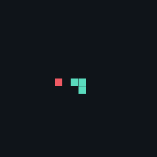
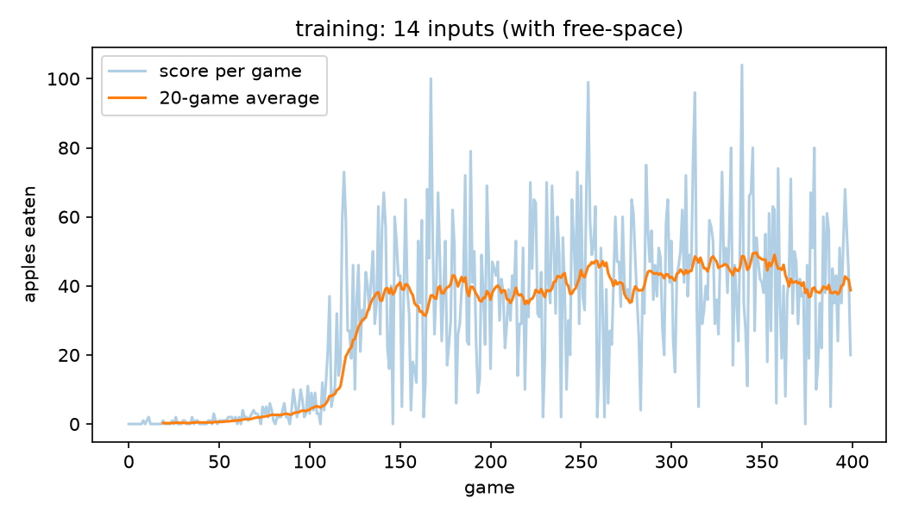

# Neural network that plays Snake (NumPy only)

**[Play the live demo](https://sammm14.github.io/snake-neural-network-numpy/demo.html)**

A Snake agent trained with Q-learning. The neural network, forward pass, loss,
backpropagation and Adam optimizer are all written by hand in NumPy.
No PyTorch or TensorFlow.

## Results

Fair evaluation: 100 games per model, greedy policy (no exploration), fixed seed.

| Model | Mean score | Std | Median | Max |
|---|---|---|---|---|
| Random policy | 0.2 | 0.4 | 0 | 1 |
| Basic (11 inputs) | 26.5 | 8.6 | 26 | 46 |
| Improved (14 inputs, adds free-space features) | 67.6 | 20.4 | 69 | 122 |

## How it works
- Basic inputs (11): danger ahead/right/left, heading (4), food direction (4)
- Improved inputs (+3): for each possible move, a flood fill measures how much free
  space is reachable, as a fraction of snake length. This tells the agent when a move
  would trap it, which the 11 local inputs cannot show.
- Network: 14 -> 64 (ReLU) -> 3 (straight, turn right, turn left)
- Learning: Q-learning with a replay buffer, epsilon-greedy exploration and a target network
  - Bellman target: r + gamma * max Q_target(s', a'), gamma = 0.9
  - Rewards: +10 for food, -10 for crashing
- Backprop by hand: dW2 = h.T @ dq, dh = (dq @ W2.T) * (h > 0), dW1 = x.T @ dh

## Verification
`python snake_nn.py gradcheck` compares the hand-written gradients with numerical
(finite-difference) gradients. The relative error is about 1e-9, so the backprop is correct.

## Run it
    pip install numpy pygame matplotlib pillow
    python snake_nn.py train          # improved agent -> weights.npz
    python snake_nn.py train basic    # baseline agent -> weights_basic.npz
    python snake_nn.py eval           # 100-game evaluation table
    python snake_nn.py gradcheck      # verify backprop
    python snake_nn.py play           # watch the AI
    python snake_nn.py versus         # you (arrow keys / WASD) vs the AI
    python snake_nn.py web            # write demo.html
    python snake_nn.py gif            # record snake.gif

## Limitations
- One training run per model; results vary between seeds.
- The agent only sees local features and a capped free-space estimate, so very long
  snakes can still trap themselves.
